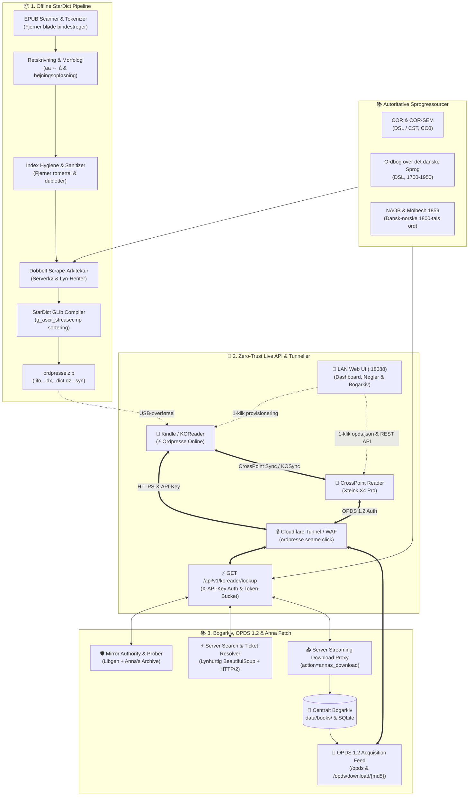
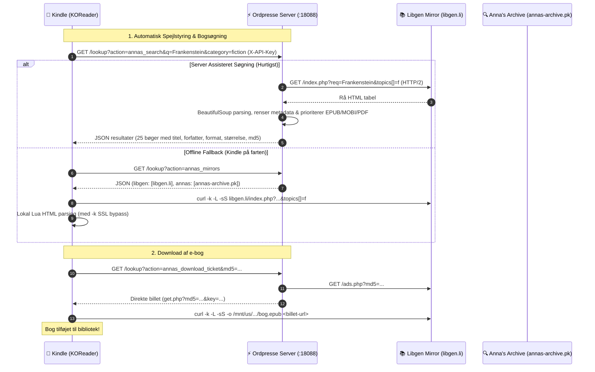

# 📖 Den Danske Ordpresse (`ordpresse`)

> **Specialiseret historisk og moderne dansk StarDict-ordbogsbygger til KOReader (Kindle, Kobo, Android e-ink, PocketBook, Onyx Boox) og `sdcv`.**

[](https://www.python.org/)
[](#-stardict-og-glib-binærsortering)
[](#-stardict-og-glib-binærsortering)
[](#-installation-i-koreader)
[](#-zero-trust-koreader-online-opslag-api--plugin)
[](LICENSE)
[](#-koreader-plugin-butik--anna-fetch-orkestrering-v126)
[](#-opds-12-bogkatalog--crosspoint-reader-xteink-x4-pro-integration-v126)
[](#-testsuite--kvalitetssikring)

---

## 🌟 Hvorfor Den Danske Ordpresse?

Når du læser klassisk og historisk dansk litteratur — hvad enten det er Vilhelm Mobergs udvandrerserie i dansk oversættelse, Henrik Pontoppidan, Steen Steensen Blicher, Ludvig Holberg eller H.C. Andersen — støder du konstant på sproglige udfordringer på din e-bogslæser:

- **Arkaiske og glemte ord:** Ord som *lægdslemmer*, *jordebog*, *bissekræmmer*, *værkbrudne*, *banco*, *rustholder* eller *husforhør* findes sjældent i almindelige nutidsordbøger.
- **Pre-1948 retskrivning:** Bøger trykt før retskrivningsreformen i 1948 bruger `aa` i stedet for `å` (*Aar*, *gaardmand*), store forbogstaver ved navneord og ældre bøjningsformer.
- **E-Ink ordbogsbegrænsninger:** Standardordbøger fejler ofte på sammensatte ord, bløde bindestreger (`\u00ad`) indsat af typografiske ombrydningsmotorer eller uregelmæssige bøjningsformer.

**Den Danske Ordpresse** løser dette ved at analysere dine egne EPUB-bøger (eller udvalgte ordlister), forene Danmarks mest autoritative ordbogskilder og kompilere en kompakt, lynhurtig og binært optimeret **StarDict v2.4.2** ordbog (`.ifo`, `.idx`, `.dict.dz`, `.syn`), der virker direkte i KOReader på Kindle, Kobo, Android og PocketBook.

---

## 🏗️ Sådan fungerer Ordpresse (Arkitektur)



---

## ✨ Hovedfunktioner

### 1. 🎯 StarDict GLib Binærsortering (`g_ascii_strcasecmp`)
KOReader og ordbogsværktøjet `sdcv` benytter GLibs `g_ascii_strcasecmp` til binærsøgning i indeksfilen (`.idx`).
- Hvis en ordbog sorteres med almindelig Python `str.lower()` eller unicode-sortering, vil binærsøgningen fejle, så snart læseren slår et ord op, der indeholder danske specialtegn (`Æ`, `Ø`, `Å`).
- Ordpresse håndterer GLib-sorteringsloven binært korrekt, så samtlige opslag rammer plet uden manglende ord.

### 2. 🔤 Retskrivning, Pre-1948 & Morfologi
- **Automatisk `aa` <-> `å` spejling:** Søgninger på *Aar* finder *år*, og omvendt.
- **Rensning af typografisk støj:** Fjerner automatisk bløde bindestreger (`\u00ad`), nul-bredde tegn (`\u200b`, `\ufeff`) og hårde linjeskift.
- **Avanceret bøjningsanalyse:** Opløser historiske og uregelmæssige bøjningsformer (*lægdslemmer* &rarr; *lægdslem*, *værkbrudne* &rarr; *værkbrudden*, *jordebøger* &rarr; *jordebog*).
- **Morfologisk sammensætningssyntese:** Forstår og samler sammensatte historiske udtryk som *dernedefra* og *uefterrettelig*.

### 3. 🧹 Index Hygiene & .syn-optimering (v0.2+)
- **Sanering af hovedord:** Fjerner historiske ordbogsartefakter som foranstillede romertal (*"iii. kvarre"* &rarr; *"kvarre"*), varemærketegn (*"eternit®"* &rarr; *"eternit"*) og etymologiske bindestreger (*"aarvaagen-hed"* &rarr; *"aarvaagenhed"*).
- **Automatisk parentesudvidelse:** Opslag med valgfrie bogstaver udvides til begge former (*"fyrstik(ke)"* &rarr; både *"fyrstik"* og *"fyrstikke"* er søgbare).
- **50% reduktion af synonymindeks (`.syn`):** Eliminerer redundante ASCII versal-dubletter (*Abbeden* / *abbeden*), da KOReader i forvejen folder ASCII case-insensitivt, mens fuld versalstøtte for danske tegn (*æ/Æ*, *ø/Ø*, *å/Å*) bevares.

### 4. ⚡ Dobbelt Scrape-Arkitektur: Serverkø & Lyn-Henter
- **Polite Server Queue:** En serverkø med en token-bucket hastighedsbegrænser (standard 200 forespørgsler/time) og Fair-Share Round-Robin koordinering, der skåner eksterne ordbogsservere mod overbelastning.
- **⚡ Ordpresse Lyn-Henter (Bookmarklet):** Hent manglende ord direkte via din egen browsers IP (350 ms/ord) med adaptiv pacing, tilfældig forsinkelse (jitter) og automatisk pause ved HTTP 429. Serverens kvote bruges ikke, og ordbogen bygges på minutter!

### 5. 📖 Skræddersyet 3-Lags E-Ink Layout (Kanonisk E-Ink v2)
Ordbogsartiklerne formatteres i et letlæseligt, højkontrast layout optimeret specifikt til e-blækskærme (f.eks. for *lægdslem*):
- **Lag 1: Hovedord, ordklasse & bøjninger:** Fremhævet hovedord med udtale, ordklasse og relevante bøjnings- og stavevarianter (f.eks. `lægdslem sb. itk. (legdelem, legdelemmer, lægdslemmer; ældre: Lægdslem, Lejdslem)`).
- **Hurtigkrog / definitionssammendrag:** Hurtigt overblik i første linje (`▸ Fattiglem tildelt et bestemt lægd til underhold og forsørgelse under den ældre fattiglovgivning.`).
- **Lag 2: Historiske betydninger (ODS / 1700–1950):** ODS-betydninger med fagspecifikke markører `(hist., landbo.)` og litterære citater.
- **Lag 3: Historisk kontekst & Kilder:** Samtidshistorisk baggrund (f.eks. omgangsforsørgelse, rotehjon) og autoritativ kildeangivelse (`Kilde: ODS · Molbech · Salmonsens`).

### 6. 💾 Hukommelsessikker Streaming (< 250 MB RAM)
DSLs COR og ODS fuldformsregistre indeholder over 3 millioner rækker. Ordpresse streamer alle datasæt direkte ind i SQLite med WAL-tilstand (*Write-Ahead Logging*) i batches af 10.000 rækker, hvilket holder RAM-forbruget under 250 MB selv på små servere eller Raspberry Pi.

### 7. 📡 Zero-Trust KOReader Online Opslag & Enhedsadgang (v0.2+)
- **Dobbelt anvendelse:** Ud over offline StarDict-kompilering fungerer Ordpresse som din egen private online ordbogsserver for KOReader.
- **To-Zone Forsvar i dybden:** Ekstern Cloudflare-adgang er strengt afgrænset til godkendte API-ruter (`GET /api/v1/koreader/lookup` og OPDS 1.2 `/opds`). Web UI, byggekø og administrations-endpoints er fuldstændig usynlige udefra (returnerer rå HTTP 404).
- **Hashed API-nøgler & Provisionering:** Hver e-bogslæser får sin egen kryptografiske API-nøgle med præfiks (*ord_...*), gemt sikkert som SHA-256 hash. Download et nøglefærdigt `ordpresse.koplugin` med 1 klik direkte fra webbrugerfladen.
- **Realtidsopslag i KOReader:** Knappen `⚡ Ordpresse Online` er integreret direkte i ordbogsvinduet, i markeringsmenuen og i KOReaders værktøjsmenu.

### 8. 🛍️ KOReader Plugin Butik & Anna Fetch Dual-Source Bogsøgning (v1.2.6+)
- **Kurateret OTA Plugin Butik:** Installer og opdater KOReader-plugins direkte fra læserens skærm uden computer eller USB-kabel.
- **Anna Fetch (Ordpresse Edition):** Dual-source orkestrering mellem Libgen (primær, rå HTML) og Anna's Archive (sekundær fallback).
- **Lyn-hurtig Server-Search (`action=annas_search`):** Serveren udfører søgningen via BeautifulSoup og HTTP/2, prioriterer læsevenlige bogformater (`epub`, `mobi`, `azw3`, `pdf`) over tegneseriehæfter, og returnerer rene resultater på < 200 ms.
- **Mirror Authority (`action=annas_mirrors`):** Automatisk periodisk prober, der tester latenstid, sorterer efter hastighed, opdager DDoS-Guard og automatisk frasorterer kaprede/parkerede domæner (`.li`, `.org`).
- **Kindle TLS-Hærdning:** Løser Kindles manglende Linux-rodcertifikater med tvungen `-k` SSL-omgåelse og søskende-opdagelse af enhedens API-nøgle.
- **Direkte Download-Billet (`action=annas_download_ticket`):** Udtrækker dynamiske Libgen `get.php` nøgler direkte for enheden.

### 9. 📚 Centralt Bogarkiv & Server Streaming Download Proxy (`action=annas_download`)
- **Automatisk Server-Arkivering:** Når en bog downloades fra Kindle/KOReader via Anna Fetch, streamer Ordpresse-serveren bogen direkte fra spejlet og gemmer den permanent i det centrale bogarkiv (`data/books/`).
- **Hukommelsessikker Streaming:** Bøger streames direkte i 64 KB bidder (`StreamingResponse`), hvilket giver øjeblikkelig downloadstart på Kindlen samtidig med at serverens RAM-forbrug forbliver under 250 MB.
- **Deduplikering & Metadata:** Registrerer automatisk bøger i `data/cache.sqlite3` (`downloaded_books`) med MD5-hash, standardiseret filnavn (`Titel_Forfatter.epub`), filstørrelse og kilde. Hvis en bog allerede findes i arkivet, serveres den øjeblikkeligt fra lokal disk uden eksternt netværkskald.
- **Kanonisk Filnavne-Hærdning:** Sanitiserer titler og forfattere til sikre tegn, fuldt kompatibelt med FAT32, ext4, Kindle OS og CrossPoint OS.

### 10. 📡 OPDS 1.2 Acquisition Feed & CrossPoint Reader Integration (v1.2.6+)
- **Universelt OPDS 1.2 Bogkatalog:** Gør hele dit centrale bogarkiv tilgængeligt over standardiseret Atom/OPDS 1.2 (`/opds` og `/api/v1/opds`) for CrossPoint Reader (Xteink X4 Pro), Calibre Wireless, Moon+ Reader og andre OPDS-kompatible e-læsere.
- **Multi-Device Læsesynkronisering (CrossPoint Sync / KOSync):** Da både KOReader (Kindle) og CrossPoint Reader henter den nøjagtig samme binære EPUB-fil med identisk indholdshash og kanonisk filnavn, virker CrossPoint Sync (KOSync-kompatibel) gnidningsfrit uden uoverensstemmelser i læseposition og bogmærker.
- **Fleksibel Zero-Trust Autentificering:** Understøtter tre parallelle godkendelsesmetoder tilpasset e-ink enheder:
  1. URL-parameter: `https://ordpresse.seame.click/opds?api_key=ord_...` (automatisk propageret til alle downloadlinks).
  2. HTTP Basic Auth: brugernavn = `ord_...`, tomt password (eller adgangskode).
  3. HTTP Header: `X-API-Key: ord_...`.
- **1-Kliks Provisionering & Flere Opsætningsveje:**
  - **Direkte REST API:** Opsætning på få sekunder via CrossPoints indbyggede webserver (`POST http://<crosspoint-ip>/api/opds`).
  - **1-Kliks `opds.json`:** Download færdigkonfigureret `opds.json` fra webinterfacet og placér den direkte i `/.crosspoint/opds.json` på SD-kortet.
  - **Katalogvælger i Web UI:** Nem administration af registrerede e-læsere, brugerdefinerede tokens og direkte kopiering af offentlige katalog-URL'er.

---

## 🚀 Kom godt i gang

Du kan køre Ordpresse lokalt på din maskine (Linux, macOS, Windows med WSL) eller via Docker.

### Forudsætninger
- **Python 3.12+** (hvis du kører lokalt uden Docker)
- **dictzip** (valgfrit værktøj til at komprimere `.dict` til `.dict.dz` — installeres via `apt install dictzip` på Debian/Ubuntu eller `brew install dictzip` på macOS)

---

### Mulighed A: Lokal kørsel med Python (Hurtigst til udvikling)

#### 1. Klon repository og opret virtuelt miljø
```bash
git clone https://github.com/massovercharge/ordpresse.git
cd ordpresse

# Opret virtuelt miljø og aktiver det
python3 -m venv .venv
source .venv/bin/activate

# Installer projektet i redigerbar tilstand
pip install -e .
```

#### 2. Kør testsuiten (Verificer at alt virker)
```bash
pytest -v
```

#### 3. Hent og opbyg officielle ordbogsdatasæt
Dette downloader DSL COR og ODS fuldformer og opretter den lokale SQLite-database `data/datasets.sqlite3`:
```bash
ordpresse fetch-datasets
```

#### 4. Start webbrugerfladen
```bash
ordpresse serve --host 127.0.0.1 --port 8088
```
Åbn herefter din browser på: **[http://localhost:8088](http://localhost:8088)**.

---

### Mulighed B: Kørsel med Docker & Docker Compose

Docker-opsætningen isolerer alle afhængigheder og gemmer databaser og færdige ordbøger persistent i `./data`.

#### 1. Start containeren
```bash
docker compose up -d --build
```

Containeren kører som standard på værtsport `18088` (for at undgå portkollisioner på servere).

#### 2. Tilgå webinterfacet
Gå til **`http://localhost:18088`** (eller **`http://<DIN_SERVER_IP>:18088`**, hvis den kører på en hjemmeserver).

#### 3. Logfiler og administration
```bash
# Se serverens logfiler
docker compose logs -f

# Stop containeren
docker compose down
```

---

## 🖥️ Webinterfacet: Taget i hånden trin-for-trin

Webinterfacet gør det utroligt nemt at bygge ordbøger og teste opslag:

```
┌─────────────────────────────────────────────────────────────────────────────────────────────────┐
│  📖 Den Danske Ordpresse v1.0.0    [Datasæt: Klar] [Ordbog: 36.963 opslag · 121.856 bøjninger]  │
├─────────────────────────────────────────────────────────────────────────────────────────────────┤
│  ⚡ Afprøv opslag (KOReader E-Ink Preview)                                                       │
│  [ lægdslemmer ] [ jordebog ] [ bissekræmmer ] [ værkbrudne ] [ banco ] [ baad ] [ daabskjole ] │
│  ┌───────────────────────────────────────────────────────────────────────────────────────────┐  │
│  │ Bøjningsopslag: lægdslemmer → lægdslem                                                    │  │
│  │                                                                                           │  │
│  │ lægdslem sb. itk. (legdelem, legdelemmer, lægdslemmer; ældre: Lægdslem, Lejdslem)         │  │
│  │ ▸ Fattiglem tildelt et bestemt lægd til underhold og forsørgelse under                    │  │
│  │   den ældre fattiglovgivning.                                                             │  │
│  │                                                                                           │  │
│  │ HISTORISK BETYDNING (ODS / 1700–1950)                                                     │  │
│  │ 1. (hist., landbo.) Fattiglem el. almisselem på landet, der forsørgedes af                │  │
│  │    lægdet, ofte ved omgangsforsørgelse fra gård til gård.                                 │  │
│  │                                                                                           │  │
│  │ [Historisk kontekst]: I 1700- og 1800-tallets Danmark og Sverige (rotehjon) var           │  │
│  │ fattigvæsenet inddelt i lægder eller roder. Arbejdsudygtige fattige gik på                │  │
│  │ skift mellem sognets gårde til 'omgangsforsørgelse'.                                      │  │
│  │                                                                                           │  │
│  │ Kilde: ODS · Molbech · Salmonsens                                                         │  │
│  └───────────────────────────────────────────────────────────────────────────────────────────┘  │
├─────────────────────────────────────────────────────────────────────────────────────────────────┤
│  ⬇ Hent komplet StarDict-ordbog (.zip)     📚 Skræddersy med egne EPUB-bøger                    │
├─────────────────────────────────────────────────────────────────────────────────────────────────┤
│  📤 Byg ordbog (Vælg omfang: (•) Fokuseret EPUB-uddrag  ( ) Komplet ordbog)                     │
│  [ 1. Vælg EPUB-bøger... ]  (eller 2. skriv specifikke ord)                                     │
│  [ Metode: (•) ⚡ Vent på Bookmarklet (Lyn-Henter)   ( ) 🐢 Automatisk server-kø ]               │
│  [ ⚙️ Byg StarDict-ordbog ]                                                                     │
└─────────────────────────────────────────────────────────────────────────────────────────────────┘
```

### 1. Afprøv opslag (E-Ink Preview)
Øverst på siden kan du teste ordbogens opslagsmotor i realtid. Klik på de forudindstillede chips (*lægdslemmer*, *jordebog*, *bissekræmmer*, *værkbrudne*, *banco*, *husforhør*, *rustholder*, *lægd*, *baad*, *daabskjole*, *overstrøet*, *efteraarsferie*) eller skriv et ord i søgefeltet for at se præcis, hvordan den kanoniske 3-lags definition vil se ud på din e-bogslæser.

### 2. 1-Kliks download eller skræddersyet byg
- **1-Kliks download:** Hent øjeblikkeligt den komplette forudbyggede ordbog (`ordpresse.zip` med 36.963 opslagsord og 121.856 bøjningsformer) direkte fra Hero-sektionen eller navigationsbaren.
- **Skræddersyet EPUB-byg:** Træk en eller flere `.epub`-filer over på upload-feltet (f.eks. Mobergs *Udvandrerne*).
- **Procesovervågning:** Følg den pædagogiske 4-trins funnel og streaminglog i realtid via Server-Sent Events (SSE).

---

## ⚡ Ordpresse Lyn-Henter (Bookmarklet Guide)

Når du bygger en ordbog fra en bog med mange sjældne historiske ord, vil der ofte være ord, som endnu ikke findes i den lokale cache. For at beskytte serveren mod rate-limiting tilbyder Ordpresse **Lyn-Henteren**:

### Hvorfor bruge bookmarkletten?
- **Ingen server-kvote bruges:** Hentningen sker direkte fra din egen browser mod `ordnet.dk`.
- **Ekstremt hurtig:** Henter med ca. 350 ms per ord i stedet for serverens 18 sekunders pause.
- **Intelligent beskyttelse:** Indeholder tilfældig tidsforsinkelse (*jitter*) og automatisk 20-sekunders pause med eksponentiel dæmpning, hvis `ordnet.dk` returnerer HTTP 429.

### Sådan gør du:
1. **Installer én gang:** Træk den gule knap **"⚡ Ordpresse Lyn-Henter"** op i din browsers bogmærkelinje (eller højreklik &rarr; *Bogmærk dette link*).
2. **Start et byg:** Start et ordbogsbyg i webinterfacet.
3. **Klik på linket til ordnet.dk:** Hvis der er ord, som mangler, viser interfacet et direkte link: *"Åbn ordnet.dk med dit Job-ID"*.
4. **Tryk på bogmærket:** Klik på dit bogmærke **"⚡ Ordpresse Lyn-Henter"** i bogmærkelinjen.
5. **Se fremdriften:** En fiks statusboks åbner i nederste højre hjørne på `ordnet.dk` og sender automatisk definitionerne tilbage til din Ordpresse-server.
6. **Færdig:** Når ordene er hentet, kompilerer Ordpresse automatisk ordbogen færdig, og du kan downloade din `.zip`-fil!

> [!TIP]
> Hvis du ikke ønsker at hente alle manglende ord, kan du til enhver tid trykke på knappen **"⏹ Stop & afslut ordbog nu"** i bookmarklet-boksen eller på webinterfacet. Ordbogen pakkes så med det samme med alle de ord, der allerede er fundet.

---

## 🛠️ CLI Kommandoer (Kommandolinje)

Ordpresse indeholder et fuldt udstyret kommandolinjeværktøj (`ordpresse`):

```bash
# 1. Hent og indekser officielle DSL COR og ODS datasæt
ordpresse fetch-datasets

# 2. Byg ordbog fra en eller flere EPUB-filer
ordpresse build --epub /sti/til/bog.epub --bookname "Min Moberg Ordbog"

# 3. Byg ordbog med specifikke ord
ordpresse build --words lægdslemmer jordebog bissekræmmer værkbrudne banco

# 4. Byg en KOMPLET ordbog over alle indekserede ord (offline)
ordpresse build --full --no-network --bookname "Den Danske Ordpresse (Fuld)"

# 5. Start webbrugerfladen
ordpresse serve --host 0.0.0.0 --port 8088

# 6. Analyser og rens cache-databasen (Triage)
ordpresse triage --db data/cache.sqlite3 --dry-run
ordpresse triage --db data/cache.sqlite3 --purged-file data/purged_words.txt
```

### CLI Flag Reference for `build`

| Flag | Type | Standard | Beskrivelse |
|---|---|---|---|
| `--epub` | Liste af stier | `[]` | En eller flere `.epub`-filer, der skal scannes. |
| `--words` | Liste af strenge | `[]` | Specifikke ord, der skal inkluderes i ordbogen. |
| `--full` | Flag | `False` | Bygger komplet ordbog over samtlige ord i databasen. |
| `--no-network` | Flag | `False` | Kører 100% offline uden at forespørge eksterne servere. |
| `--output` | Sti | `data/output` | Mappe hvor den færdige `.zip` og StarDict-filer gemmes. |
| `--bookname` | Streng | *"Den Danske Ordpresse (1700-nu)"* | Ordbogens viste navn i KOReader. |

---

## 📱 Installation i KOReader (Kindle, Kobo, Android)

Når ordbogen er bygget, modtager du filen `ordpresse.zip`.

```
data/output/
└── build_xxxxxx/
    ├── ordpresse.ifo      <- Ordbogens metadata og formatversion
    ├── ordpresse.idx      <- Binært GLib-sorteret indeks
    ├── ordpresse.dict.dz  <- Komprimeret definitionsdata (eller .dict)
    ├── ordpresse.syn      <- Bøjningsformer og stavevarianter
    └── ordpresse.zip      <- Komplet pakke klar til e-bogslæser
```

### Trin-for-trin installationsvejledning:

1. **Hent ordbogsfilen:** Download `ordpresse.zip` fra webinterfacet eller find den i `data/output/`.
2. **Udpak arkivet:** Udpak zip-filen på din computer. Du får en mappe kaldet `ordpresse/` med de fire filer (`.ifo`, `.idx`, `.dict.dz`, `.syn`).
3. **Overfør til din e-bogslæser:**
   - Slut din enhed (Kindle, Kobo, Onyx Boox, PocketBook el. Android) til computeren via USB-kabel.
   - Kopier mappen `ordpresse/` til KOReaders ordbogsbibliotek:
     - **Kindle / Kobo / PocketBook:** `<Enhed>/koreader/data/dict/ordpresse/`
     - **Android enheder:** `/sdcard/koreader/data/dict/ordpresse/`
4. **Genstart KOReader & aktivér ordbogen:**
   - Genstart KOReader (eller genstart e-læseren), så KOReader scanner og indekserer den nye ordbogsmappe ved opstart.
   - Åbn en bog i KOReader &rarr; tryk øverst på skærmen for at åbne hovedmenuen &rarr; Vælg **Bog/Læseindstillinger** (eller tandhjulsikonet).
   - Vælg **Ordbogsindstillinger** (*Dictionary settings*).
   - Kontroller, at **Den Danske Ordpresse** fremgår af listen og er slået til (afkrydset som primær ordbog).
5. **Afprøv et opslag:**
   - Åbn en historisk bog i KOReader og hold fingeren nede på et ord som *lægdslemmer* eller *bissekræmmer*.
   - Ordbogsvinduet popper øjeblikkeligt op med den fulde historiske definition!

---

## 📡 Zero-Trust KOReader Online Opslag (API & Plugin)

Fra version **0.2+** fungerer Den Danske Ordpresse ikke blot som en offline ordbogsgenerator, men også som din egen private, krypterede **online ordbogsserver for KOReader**. Når du støder på et sjældent ord under læsningen, som ikke er med i dit offline StarDict-uddrag, kan du slå det op online på få millisekunder direkte fra e-læserens skærm.

### 1. To-Zone Sikkerhedsarkitektur (Defense-in-Depth)

Ordpresse implementerer en kompromisløs **Two-Zone Boundary**:

```
[ Offentligt Internet / Cloudflare Tunnel ]
                    │
                    ▼
     GET /api/v1/koreader/lookup?q=...  ──(X-API-Key)──► [ ✅ Godkendt: Live Opslag ]
     Enhver anden URL (f.eks. /, /api/...) ─────────────► [ ❌ HTTP 404 Not Found ]

[ Privat LAN / Hjemmenetværk (:18088) ]
                    │
                    ▼
     / (Web UI), /api/build, /api/v1/keys/... ─────────► [ 🔐 Kræver LAN Login ]
```

- **Ekstern Zone (Cloudflare Tunnel):** Kun det ene endpoint `GET /api/v1/koreader/lookup?q=...` lukkes igennem. Enhver forespørgsel mod webinterfacet, byggekøen eller administrations-endpoints udefra besvares omgående med en rå `HTTP 404 Not Found`, så angribere slet ikke kan opdage, at der kører en applikation.
- **Lokal Zone (LAN):** Webbrugerfladen og alle styringsværktøjer er udelukkende tilgængelige på det lokale netværk og er beskyttet af et adgangskodelogin med en kryptografisk signeret sessionscookie (`ordpresse_session`). Du kan ændre din adgangskode når som helst direkte i webinterfacet under knappen **"🔑 Skift kode"**.

### 2. Enhedsstyring & 1-Kliks Provisionering

Under sektionen **Enhedsadgang & KOReader Integration** i webbrugerfladen kan du administrere dine e-bogslæsere:

1. **Opret enhedsnøgle:** Indtast navnet på din enhed (f.eks. *Kobo Clara*, *Boox Palma 2*, *Kindle Paperwhite*) og klik på **"Opret nøgle & hent plugin"**.
2. **Kryptografisk sikkerhed:** Hver enhed får tildelt en unik API-nøgle med præfikset `ord_` (52 tegn). Nøglen hashes med SHA-256, inden den gemmes i databasen — den rå nøgle gemmes aldrig på serveren.
3. **Livscyklus:** Du kan til enhver tid deaktivere (*Tilbagekald*) eller permanent slette en enheds adgang direkte fra oversigten.

### 3. Installation af KOReader-pluginet (`ordpresse.koplugin`)

Når du opretter en enhed, genererer serveren automatisk en skræddersyet, zero-config `ordpresse-koplugin-<enhed>.zip`:

1. **Udpak zip-filen** på din computer. Den indeholder mappen `ordpresse.koplugin/` med tre filer:
   - `_meta.lua`: Plugin-metadata og beskrivelse.
   - `config.lua`: Forudindstillet med serverens offentlige URL og enhedens unikke API-nøgle.
   - `main.lua`: KOReaders integrationshooks.
2. **Kopiér mappen** over på din e-bogslæser:
   ```text
   koreader/plugins/ordpresse.koplugin/
   ```
3. **Genstart KOReader.** Pluginet er nu aktivt og integreret i fem centrale dele af KOReader:
   - **Ordbogsvinduet:** Når du tapper et ord i en bog, indeholder ordbogsvinduet knappen **`⚡ Ordpresse Online`** forrest i knaprækken.
   - **Markeringsmenuen:** Når du markerer et ord eller en sætning, vises **`⚡ Slå op i Ordpresse (Online)`** direkte i menuen.
   - **Hovedmenuen:** Under KOReaders søgemenu (forstørrelsesglasset) finder du **`⚡ Ordpresse Online Opslag`**, hvor du frit kan indtaste et vilkårligt ord på skærmtastaturet.
   - **1-Kliks Opdatering (In-App):** Under værktøjsmenuen finder du **`🔄 Ordpresse: Søg efter opdateringer`**. Når der frigives nye forbedringer på din Ordpresse-server, kan du hente og installere den nyeste version direkte fra e-bogslæserens skærm med et enkelt tryk – helt uden computer eller USB-kabel!
   - **🛍️ Ordpresse Plugin Butik:** Under værktøjsmenuen finder du **`🛍️ Ordpresse Plugin Butik`**, hvor du kan gennemse og installere kuraterede tredjeparts-plugins med et enkelt tryk.

### 4. Cloudflare Tunnel WAF Skip-Regel (Vigtigt)

For at sikre, at KOReaders online opslag ikke blokeres af Cloudflares automatiske bot-beskyttelse eller managed rules, skal der oprettes en **WAF Custom Rule** i Cloudflare Dashboard:

1. Gå til dit domæne i **Cloudflare Dashboard** &rarr; **Security** &rarr; **WAF** &rarr; **Custom rules**.
2. Klik på **Create rule** og giv den navnet `Allow KOReader Lookup and OPDS`.
3. Indstil betingelsen:
   - Field: `URI Path`
   - Operator: `is in` (eller sammensæt med OR)
   - Values: `/api/v1/koreader/lookup`, `/opds`, `/api/v1/opds` samt `URI Path starts with /opds/download/`
   *(Expression preview: `(http.request.uri.path in {"/api/v1/koreader/lookup" "/opds" "/api/v1/opds"} or starts_with(http.request.uri.path, "/opds/download/"))`)*
4. Vælg handlingen (**Choose action**): **Skip**.
5. Sæt flueben i:
   - ☑ *All remaining custom rules*
   - ☑ *All rate limiting rules*
   - ☑ *All managed rules*
   - ☑ *All Super Bot Fight Mode Rules*
6. Gem og aktivér reglen (**Deploy**).

Nu kan din e-bogslæser og CrossPoint foretage lynhurtige online opslag og hente e-bøger hvor som helst, så længe de har internetforbindelse.

### 5. 🛍️ KOReader Plugin Butik & Anna Fetch Orkestrering (v1.2.6+) <a id="-koreader-plugin-butik--anna-fetch-orkestrering-v126"></a>

I takt med at KOReader community-plugins udvides, opstår der ofte kritiske driftsproblemer på e-bogslæsere:
- **Upstream OTA-fejl:** GitHub API rate-limits, blokerede stinavne (`plugins/annas-fetch.koplugin` vs `plugins/annas-fetch`) og inkompatible zipball-strukturer bryder hyppigt automatiske opdateringer.
- **DNS-blokeringer og Cloudflare challenges:** I Danmark blokerer internetudbydere via DNS for kendte skyggebiblioteker, og sider som Anna's Archive kræver JavaScript-løsning af DDoS-Guard / Cloudflare Turnstile, som en Kindles minimale browser/curl ikke kan gennemføre.
- **Kindle SSL/TLS rodcertifikater:** Amazon Kindles indlejrede Linux mangler opdaterede CA-rodcertifikater i `/etc/ssl/certs`, hvorved rå `curl` over HTTPS fejler med SSL-fejl 60 medmindre `-k` anvendes.
- **Søgestøj & manglende kategorifiltre:** Uden emnefiltrering oversvømmes søgninger af irrelevante videnskabelige artikler. Ordpresse introducerer en dynamisk kategorivælger (**Alle bøger**, **Skønlitteratur**, **Faglitteratur**, **Tegneserier**, **Magasiner** og **Artikler**) direkte i Kindlens søgedialog og i web-interfacet.

Den Danske Ordpresse løser dette ved at agere **lokal distributionscentral, mirror authority og søgemotor-proxy**:



#### Nøglekomponenter i Plugin-orkestreringen:
1. **Kurateret OTA Plugin Butik:**
   - E-læseren kalder `action=store_catalog` for at hente det godkendte katalog.
   - Ved opdatering kalder den `action=store_download&id=annas-fetch`, hvor Ordpresse streamer et færdigpakket zip-arkiv genereret direkte fra de kuraterede kildefiler i `src/ordpresse/vendor/annas-fetch.koplugin/`.
2. **Mirror Authority (`action=annas_mirrors`):**
   - Prober-servicen tester periodisk Libgen og Anna's Archive kandidatdomæner.
   - Frasorterer overtagne/parkerede domæner (`annas-archive.li`, `annas-archive.org`).
   - Måler TCP/TLS svartid og rangerer de hurtigste fungerende spejle øverst med 3600 sekunders cache og eksponentiel backoff for fejlede værter.
3. **Server-Assisteret Bogsøgning (`action=annas_search`):**
   - Kindlen sender søgetermen til Ordpresse, som foretager forespørgslen med moderne HTTP/2 og BeautifulSoup.
   - Omgår danske udbyderes DNS-blokeringer og Kindle CPU-belastning.
   - Formatsortering: Prioriterer altid `epub`, `mobi`, `azw3` og `pdf` øverst frem for store tegneseriearkiver (`cbz`/`cbr`).
   - Responstid: Under 200 ms mod e-læseren.
4. **Dynamisk Billet-Opløsning (`action=annas_download_ticket`):**
   - Henter automatisk engangs-tokens fra Libgens `ads.php`, så e-læseren kan hente den rene binære bogfil direkte uden at skulle håndtere reklamebannere eller mellemsider.
5. **Kindle Klienthærdning (`annas-fetch.koplugin`):**
   - **`-k` (`--insecure`) og `-sS`:** `curl`-kald fra Kindle eksekveres med SSL-verifikationsomgåelse, så certifikatfejl på Amazon Linux undgås.
   - **Zero-config Søskendeopdagelse:** Læser automatisk API-nøgle og serverendpoint fra `plugins/ordpresse.koplugin/config.lua`.
   - **Offline-robust:** Hvis e-læseren er uden for hjemmenetværket, falder den automatisk tilbage til den lokale spejlcache og direkte klient-scraping.

---

### 6. 📡 OPDS 1.2 Bogkatalog & CrossPoint Reader (Xteink X4 Pro) Integration <a id="-opds-12-bogkatalog--crosspoint-reader-xteink-x4-pro-integration-v126"></a>

Fra version **1.2.6+** understøtter Den Danske Ordpresse et fuldt integreret **OPDS 1.2 Acquisition Feed**, der gør dit private bogarkiv tilgængeligt for kompakte mikro-e-ink læsere som **CrossPoint Reader (Xteink X4 Pro)**, Calibre Wireless, KOReader og Moon+ Reader.

#### Hvorfor OPDS og CrossPoint?
1. **Multi-Device Læsesynkronisering (CrossPoint Sync / KOSync):**
   - CrossPoint OS benytter en KOSync-kompatibel synkroniseringsprotokol (`koMatchMethod: 0` = Filnavn, samt delvist byte-hash).
   - Når du finder og henter en bog via din Kindle, gemmer Ordpresse den i det centrale arkiv. Når du efterfølgende åbner Ordpresse OPDS-kataloget på din CrossPoint Reader og downloader bogen, modtager den en **binært byte-identisk EPUB-fil** med præcis samme kanoniske filnavn (`Titel_Forfatter.epub`).
   - Resultat: Du kan skifte frit mellem din store Kindle derhjemme og din lommevenlige CrossPoint på farten – læseposition, side og bogmærker synkroniseres 100% automatisk!
2. **Zero-Trust URL & Sikkerhed:**
   - Kataloget er fuldstændig privat og kræver en gyldig enheds-API-nøgle (`ord_...`).
   - Understøtter tre parallelle autentificeringsmetoder:
     - **URL-parameter:** `https://ordpresse.seame.click/opds?api_key=ord_...` (propagerer automatisk nøglen til alle bog-downloadlinks i feedet).
     - **HTTP Basic Auth:** Brugernavn = `ord_...`, Kode = valgfri/tom.
     - **HTTP Header:** `X-API-Key: ord_...`.

#### Tre Nemme Opsætningsmetoder for CrossPoint

##### Metode 1: Direkte REST API via Wi-Fi / Hotspot (Anbefalet & Hurtigst)
Når din CrossPoint Reader er tændt og forbundet til Wi-Fi (eller telefonens delte internet), kører den en intern REST API server på sin IP (f.eks. `172.20.10.3` eller `crosspoint.local`):

```bash
# 1. Tilføj Ordpresse OPDS kataloget direkte til CrossPoint Reader
curl -X POST http://<CROSSPOINT_IP>/api/opds \
  -H "Content-Type: application/json" \
  -d '{
    "name": "Ordpresse",
    "url": "https://ordpresse.seame.click/opds?api_key=<DIN_API_NØGLE>",
    "username": "<DIN_API_NØGLE>"
  }'

# 2. Indstil optimal downloadmappe og filnavneformat for KOSync
curl -X POST http://<CROSSPOINT_IP>/api/settings \
  -H "Content-Type: application/json" \
  -d '{
    "opdsDownloadFolder": "Pushed Books",
    "opdsFilenameFormat": 1
  }'
```

##### Metode 2: 1-Kliks `opds.json` til SD-kort
1. Åbn Ordpresse webinterfacet (`http://192.168.50.5:18088`).
2. Rul ned til sektionen **"Centralt Bogarkiv & CrossPoint OPDS"**.
3. Vælg din enhed (eller opret en ny under Enhedsadgang) og klik på **"⬇ Hent opds.json"**.
4. Sæt SD-kortet i din computer og gem filen som `/.crosspoint/opds.json`.
5. Sæt kortet tilbage i CrossPoint – kataloget er klar med det samme!

##### Metode 3: Manuel indtastning i CrossPoint Web UI
1. Åbn `http://crosspoint.local/settings` (eller IP-adressen) i en browser på din telefon eller computer på samme netværk.
2. Gå til sektionen **OPDS Servers** &rarr; **Add Server**.
3. Udfyld felterne:
   - **Name:** `Ordpresse`
   - **URL:** `https://ordpresse.seame.click/opds?api_key=<DIN_API_NØGLE>`
   - **Username:** `<DIN_API_NØGLE>`
4. Tryk på **Save**.

##### Kritiske CrossPoint OS Indstillinger
For at sikre, at CrossPoint gemmer bøgerne så de synkroniseres perfekt med KOSync:
- **`opdsDownloadFolder`**: Sættes til `"Pushed Books"` (eller din foretrukne bogmappe på SD-kortet).
- **`opdsFilenameFormat`**: Sættes til `1` (`Title - Author`), så filnavnene matcher KOReader.

---

### 7. 📚 Centralt Bogarkiv & Server Streaming Proxy

Når du søger og downloader bøger i KOReader via Anna Fetch-pluginet, håndterer Ordpresse-serveren hele processen transparent:

1. **Streaming Download Proxy (`action=annas_download`):**
   - E-læseren kalder Ordpresse med bogens MD5-hash.
   - Serveren forbinder til det hurtigste verificerede spejl og streamer bogen direkte til e-læseren i 64 KB datablokke.
   - Samtidig gemmes bogen på serverens disk i mappen `data/books/` under et kanonisk filnavn (`Titel_Forfatter.epub`).
2. **Instant Cache / Deduplikering:**
   - Hvis en bog allerede er hentet én gang, serveres den lynhurtigt fra det lokale arkiv uden eksterne forespørgsler.
   - Metadata registreres i SQLite (`downloaded_books`) med titel, forfatter, filstørrelse og kilde.
3. **Web UI Bogarkiv:**
   - I webbrugerfladen under *Centralt Bogarkiv* kan du se alle downloadede bøger, hente dem direkte til din computer, eller slette bøger med et enkelt klik.

---

### 8. 🌐 REST API Endpoints Reference

| Endpoint | Metode | Autentificering | Beskrivelse |
|---|---|---|---|
| `/health` | `GET` | Ingen | Serverens helbredstilstand, version og database-status. |
| `/api/v1/koreader/lookup` | `GET` | `X-API-Key` / query | KOReader live opslag for ord og historiske betydninger. |
| `/api/v1/koreader/lookup?action=annas_search` | `GET` | `X-API-Key` / query | Lynhurtig server-aflastet bogsøgning mod Libgen. |
| `/api/v1/koreader/lookup?action=annas_mirrors` | `GET` | `X-API-Key` / query | Aktive spejle rangordnet efter latenstid og oppetid. |
| `/api/v1/koreader/lookup?action=annas_download_ticket` | `GET` | `X-API-Key` / query | Opløser dynamiske Libgen `get.php` engangsbilletter. |
| `/api/v1/koreader/lookup?action=annas_download` | `GET` | `X-API-Key` / query | Server streaming download proxy & automatisk bogarkivering. |
| `/api/v1/koreader/lookup?action=store_catalog` | `GET` | `X-API-Key` / query | Henter OTA kataloget over kuraterede KOReader-plugins. |
| `/api/v1/koreader/lookup?action=store_download&id=...` | `GET` | `X-API-Key` / query | Downloader færdigpakket plugin-zipball (OTA opdatering). |
| `/opds` el. `/api/v1/opds` | `GET` | `?api_key=` / Basic / Header | OPDS 1.2 XML/Atom bogkatalog for CrossPoint & Calibre. |
| `/opds/download/{md5}` | `GET` | `?api_key=` / Basic / Header | Direkte binær streaming download af EPUB for OPDS læsere. |
| `/api/books` | `GET` | Session cookie / `X-API-Key` | Liste over alle arkiverede bøger i JSON-format. |
| `/api/books/{md5}` | `GET` | Session cookie / `X-API-Key` | Direkte download af en specifik arkiveret bogfil. |
| `/api/books/{md5}` | `DELETE` | Administrator session | Sletter en bog permanent fra databasen og serverens disk. |

---

## ⚙️ Konfiguration & Miljøvariabler

Ordpresse konfigureres via miljøvariabler, som kan sættes direkte i dit shell-miljø eller i en `.env`-fil:

| Miljøvariabel | Standardværdi | Beskrivelse |
|---|---|---|
| `ORDPRESSE_DATA_DIR` | `<projekt>/data` | Mappe til databaser, rå downloads og output. |
| `PORT` | `8088` | Porten webserveren lytter på internt i Python. |
| `HOST` | `0.0.0.0` | Netværksinterface webserveren binder til. |
| `HOST_PORT` | `18088` | Værtsport for Docker Compose mapping (`HOST_PORT:8088`). |
| `ORDPRESSE_ADMIN_PASSWORD` | `ordpresse` | Standard administratoradgangskode for LAN-webinterfacet (kan ændres i UI'et). |
| `ORDPRESSE_DISABLE_AUTH` | `false` | Sæt til `true` for at deaktivere login-kravet på LAN (anbefales kun til test). |
| `ORDPRESSE_MAX_HOURLY_REQUESTS` | `200` | Maksimalt antal live HTTP-forespørgsler per time fra serverens IP. |
| `ORDPRESSE_BURST_TOKENS` | `10` | Antal indledende forespørgsler serveren må udføre uden pause. |
| `ORDPRESSE_REQUEST_DELAY` | `0.5` | Høflighedspause (i sekunder) mellem forespørgsler. |
| `ORDPRESSE_MIN_WORD_FREQ` | `2` | Minimum antal forekomster af et ukendt ord i en EPUB før opslag. |
| `ORDPRESSE_MAX_ONLINE_BATCH` | `50000` | Sikkerhedsloft over ord registreret i et enkelt byg. |

---

## 🌐 Server Deployment & Reverse Proxy (Agnostisk)

Hvis du ønsker at køre Ordpresse på en dedikeret server, NAS eller Raspberry Pi og tilgå den udefra, anbefales det at placere den bag en reverse proxy eller tunnel:

### Reverse Proxy Eksempel (Nginx / Caddy / Traefik)
Ordpresse benytter Server-Sent Events (SSE) til at streame byggeforløb. Sørg for at slå buffering fra i din proxy:

```nginx
server {
    server_name ordpresse.ditdomæne.dk;

    location / {
        proxy_pass http://<SERVER_IP>:18088;
        proxy_http_version 1.1;
        proxy_set_header Host $host;
        proxy_set_header X-Real-IP $remote_addr;
        proxy_set_header X-Forwarded-For $proxy_add_x_forwarded_for;
        proxy_set_header X-Forwarded-Proto $scheme;

        # Vigtigt for SSE live-streaming:
        proxy_set_header Connection '';
        proxy_buffering off;
        proxy_cache off;
        chunked_transfer_encoding off;
    }
}
```

### Cloudflare Zero Trust Tunnel
Hvis du benytter Cloudflare Tunnels (`cloudflared`):
1. Opret et **Public Hostname** i dit Cloudflare Zero Trust Dashboard.
2. Sæt **Service** til `HTTP`.
3. Sæt **URL** til `http://<DIN_INTERNE_SERVER_IP>:18088` (eller `http://ordpresse:8088`, hvis tunnel-containeren er på samme Docker-netværk).
4. Ordpresse sender automatisk `: keepalive-ping` kommentarer hvert 15. sekund over SSE-forbindelsen for at forhindre Cloudflare HTTP 524 timeouts under store ordbogsbyg.

> [!NOTE]
> For private installationsdetaljer, IP-adresser og server-specifikke SSH-kommandoer henvises til din lokale `DEPLOYMENT_LOCAL.md`-fil, som holdes uden for versionsstyring.

---

## 🧪 Testsuite & Kvalitetssikring

Projektet har en omfattende automatiseret testsuite med **111 tests**, der sikrer leksikalsk, kryptografisk og binær integritet:

```bash
# Kør hele testsuiten
pytest -v
```

### Hvad dækker testene?
- **`tests/test_opds_and_books.py`:** Verificerer OPDS 1.2 XML/Atom parsing og acquisition links, MD5 streaming-download, centralt bogarkiv persistence (`data/books/`), deduplikering af downloads, samt adgangskontrol på tværs af query-parametre (`?api_key=`), HTTP Basic Auth (`ord_...`), Bearer tokens og LAN session-cookies.
- **`tests/test_annas_integration.py`:** Verificerer spejlovervågning, frasortering af parkerede domæner, in-memory zip-pakning af `annas-fetch.koplugin`, `action=store_download`, `action=annas_mirrors`, server-assisteret bogsøgning (`action=annas_search`), download-billet opløsning (`action=annas_download_ticket`) og streaming download proxy (`action=annas_download`).
- **`tests/test_koreader_online.py`:** Verificerer Zero-Trust to-zone grænsen (HTTP 404 for eksterne ikke-lookup/ikke-opds stier), LAN login-flow, signerede session-cookies, hashed API-nøgle provisionering og livscyklus, KOReader plugin-generering (`addToDictButtons`, `addToHighlightDialog`, `onDictButtonsReady`), rate-limiting, negativ caching, in-app plugin-opdateringer og skift af administratoradgangskode.
- **`tests/test_stardict_writer.py`:** Verificerer GLib `g_ascii_strcasecmp` sorteringsloven, binærlæsning og StarDict v2.4.2 overholdelse.
- **`tests/test_index_hygiene.py`:** Verificerer sanering af romertal, parentesudvidelse, varemærkestripning og eliminering af ASCII versal-dubletter i `.syn`.
- **`tests/test_lexical_integrity.py`:** Verificerer 3-lags prioriteringssystem, bøjningsvalidering og beskyttelse mod forkortede COR-SEM definitioner.
- **`tests/test_rate_limiter_and_peer.py`:** Verificerer token-bucket begrænser, fair-share kø, CORS headers og Ordpresse Lyn-Henter integration.
- **`tests/test_moberg_words.py`:** End-to-end regressionstest af de klassiske Moberg-nøgleord i en simuleret EPUB.
- **`tests/test_orthography.py`:** Verificerer `aa` <-> `å` konvertering, bløde bindestreger og bøjningsopløsning.
- **`tests/test_ods_subsenses_and_coverage.py`:** Verificerer ODS underbetydninger, dækningsgrad, enkeltlags overstrø-polering og syntakshale-sanering.
- **`tests/test_cache_persistence_and_queue.py`:** Verificerer renhed af cache-rækker, ODS sidebar-rensning og ekspansion af negativ cache.
- **`tests/test_cor_grammatical_resolution.py`:** Verificerer lokal grammatisk opløsning mod COR-databasen og `aa`-spejling.
- **`tests/test_aa_and_genitives.py`:** Verificerer beskæring af redundante genitiver, forkortelser og kunstige ODS-synonymer.
- **`tests/test_text_formatting.py`:** Verificerer sætningsafgrænsning, definitionssammendrag og fuldsætningsbevarelse.
- **`tests/test_quality_and_triage.py`:** Verificerer automatisk triage-sanering, defekt rensning og databaserobusthed.
- **`tests/test_api.py`:** Verificerer HTTP statuskoder for web UI endpoints, datasæt-status og SSE hændelsesstrømme.

---

## 📜 Lovpligtig kreditering og kildelicenser

Den Danske Ordpresse er et uafhængigt open-source projekt udviklet til personlig, ikke-kommerciel læsning på e-bogslæsere. Ordbogsdata bygger på åbne sprogressourcer fra følgende institutioner:

1. **Det Danske Sprog- og Litteraturselskab (DSL):**
   - Data fra **Ordbog over det danske Sprog (ODS)** samt **ODS fuldformsleksikon** (udarbejdet af Thomas Troelsgård, DSL) benyttes i overensstemmelse med [DSL's åbne sprogressourcer](https://korpus.dsl.dk/resources/licences/dsl-open.html). Besøg [dsl.dk](https://dsl.dk) og [ordnet.dk/ods](https://ordnet.dk/ods).
   - *Henstilling:* DSL krediteres i overensstemmelse med licensen. DSL støtter eller godkender ikke dette tredjepartsværktøj eller dets anvendelse.
2. **Det Centrale Ordregister (COR & COR-SEM):**
   - Udviklet og udgivet af **Det Danske Sprog- og Litteraturselskab (DSL)** og **Center for Sprogteknologi (CST, Københavns Universitet)**. Distribueret via [ordregister.dk](https://ordregister.dk) under **[Creative Commons CC0 1.0 Universal (Public Domain Dedication)](https://creativecommons.org/publicdomain/zero/1.0/)**.
3. **Det Norske Akademi for Språk og Litteratur (NAOB) & Public Domain-kilder:**
   - Supplerende referencer for fælles dansk-norske og nordiske 1800-talstermer fra [naob.no](https://naob.no), Chr. Molbechs *Dansk Ordbog* (1859) og *Salmonsens Konversationsleksikon* (2. udg., Project Runeberg).

*Ansvarsfraskrivelse:* Den Danske Ordpresse udgives ikke i kommerciel konkurrence med DSL's egne digitale ordbøger (f.eks. ordnet.dk) og er udelukkende beregnet til privat brug på personlige e-bogslæsere.

---

## 📄 Licens

Kildekoden til Den Danske Ordpresse er licenseret under [MIT License](LICENSE).
