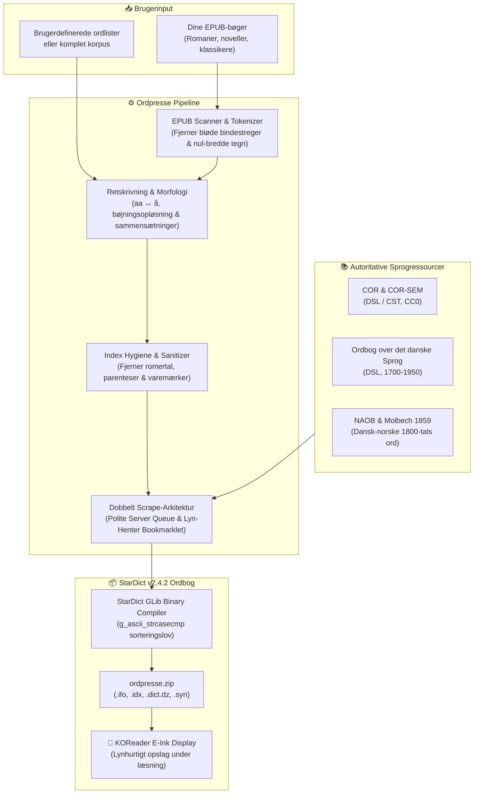

# 📖 Den Danske Ordpresse (`ordpresse`)

> **Specialiseret historisk og moderne dansk StarDict-ordbogsbygger til KOReader (Kindle, Kobo, Android e-ink, PocketBook, Onyx Boox) og `sdcv`.**

[](https://www.python.org/)
[](#-stardict-og-glib-binærsortering)
[](#-stardict-og-glib-binærsortering)
[](#-installation-i-koreader)
[](LICENSE)
[](#-testsuite--kvalitetssikring)

---

## 🌟 Hvorfor Den Danske Ordpresse?

Når du læser klassisk og historisk dansk litteratur — hvad enten det er Vilhelm Mobergs udvandrerserie i dansk oversættelse, Henrik Pontoppidan, Steen Steensen Blicher, Ludvig Holberg eller H.C. Andersen — støder du konstant på sproglige udfordringer på din e-bogslæser:

- **Arkaiske og glemte ord:** Ord som *lægdslemmer*, *jordebog*, *bissekræmmer*, *værkbrudne*, *banco*, *rustholder* eller *husforhør* findes sjældent i almindelige nutidsordbøger.
- **Pre-1948 retskrivning:** Bøger trykt før retskrivningsreformen i 1948 bruger `aa` i stedet for `å` (*Aar*, *gaardmand*), store forbogstaver ved navneord og ældre bøjningsformer.
- **E-Ink ordbogsbegrænsninger:** Standardordbøger fejler ofte på sammensatte ord, bløde bindestreger (`\u00ad`) indsat af typografiske ombrydningsmotorer eller uregelmæssige bøjningsformer.

**Den Danske Ordpresse** løser dette ved at analysere dine egne EPUB-bøger (eller udvalgte ordlister), forene Danmarks mest autoritative ordbogskilder og kompilere en kompakt, lynhurtig og binært optimeret **StarDict v2.4.2** ordbog (`.ifo`, `.idx`, `.dict.dz`, `.syn`), der virker direkte i KOReader på Kindle, Kobo, Android og PocketBook.

---

## 🏗️ Sådan fungerer Ordpresse (Arkitektur)



---

## ✨ Hovedfunktioner

### 1. 🎯 StarDict GLib Binærsortering (`g_ascii_strcasecmp`)
KOReader og ordbogsværktøjet `sdcv` benytter GLibs `g_ascii_strcasecmp` til binærsøgning i indeksfilen (`.idx`).
- Hvis en ordbog sorteres med almindelig Python `str.lower()` eller unicode-sortering, vil binærsøgningen fejle, så snart læseren slår et ord op, der indeholder danske specialtegn (`Æ`, `Ø`, `Å`).
- Ordpresse håndterer GLib-sorteringsloven binært korrekt, så samtlige opslag rammer plet uden manglende ord.

### 2. 🔤 Retskrivning, Pre-1948 & Morfologi
- **Automatisk `aa` <-> `å` spejling:** Søgninger på *Aar* finder *år*, og omvendt.
- **Rensning af typografisk støj:** Fjerner automatisk bløde bindestreger (`\u00ad`), nul-bredde tegn (`\u200b`, `\ufeff`) og hårde linjeskift.
- **Avanceret bøjningsanalyse:** Opløser historiske og uregelmæssige bøjningsformer (*lægdslemmer* &rarr; *lægdslem*, *værkbrudne* &rarr; *værkbrudden*, *jordebøger* &rarr; *jordebog*).
- **Morfologisk sammensætningssyntese:** Forstår og samler sammensatte historiske udtryk som *dernedefra* og *uefterrettelig*.

### 3. 🧹 Index Hygiene & .syn-optimering (v0.2+)
- **Sanering af hovedord:** Fjerner historiske ordbogsartefakter som foranstillede romertal (*"iii. kvarre"* &rarr; *"kvarre"*), varemærketegn (*"eternit®"* &rarr; *"eternit"*) og etymologiske bindestreger (*"aarvaagen-hed"* &rarr; *"aarvaagenhed"*).
- **Automatisk parentesudvidelse:** Opslag med valgfrie bogstaver udvides til begge former (*"fyrstik(ke)"* &rarr; både *"fyrstik"* og *"fyrstikke"* er søgbare).
- **50% reduktion af synonymindeks (`.syn`):** Eliminerer redundante ASCII versal-dubletter (*Abbeden* / *abbeden*), da KOReader i forvejen folder ASCII case-insensitivt, mens fuld versalstøtte for danske tegn (*æ/Æ*, *ø/Ø*, *å/Å*) bevares.

### 4. ⚡ Dobbelt Scrape-Arkitektur: Serverkø & Lyn-Henter
- **Polite Server Queue:** En serverkø med en token-bucket hastighedsbegrænser (standard 200 forespørgsler/time) og Fair-Share Round-Robin koordinering, der skåner eksterne ordbogsservere mod overbelastning.
- **⚡ Ordpresse Lyn-Henter (Bookmarklet):** Hent manglende ord direkte via din egen browsers IP (350 ms/ord) med adaptiv pacing, tilfældig forsinkelse (jitter) og automatisk pause ved HTTP 429. Serverens kvote bruges ikke, og ordbogen bygges på minutter!

### 5. 📖 Skræddersyet 3-Lags E-Ink Layout
Ordbogsartiklerne formatteres i et letlæseligt, højkontrast layout optimeret specifikt til e-blækskærme:
- **Hovedord & Udtale:** Fremhævet med tydelig skriftstørrelse.
- **Ordklasse & Bøjninger:** Kompakt oversigt over bøjningsformer.
- **Historiske betydninger (ODS):** Fuldstændige historiske definitioner med citater.
- **Moderne betydninger (COR-SEM):** Kontekstuelle moderne definitioner.

### 6. 💾 Hukommelsessikker Streaming (< 250 MB RAM)
DSLs COR og ODS fuldformsregistre indeholder over 3 millioner rækker. Ordpresse streamer alle datasæt direkte ind i SQLite med WAL-tilstand (*Write-Ahead Logging*) i batches af 10.000 rækker, hvilket holder RAM-forbruget under 250 MB selv på små servere eller Raspberry Pi.

---

## 🚀 Kom godt i gang

Du kan køre Ordpresse lokalt på din maskine (Linux, macOS, Windows med WSL) eller via Docker.

### Forudsætninger
- **Python 3.12+** (hvis du kører lokalt uden Docker)
- **dictzip** (valgfrit værktøj til at komprimere `.dict` til `.dict.dz` — installeres via `apt install dictzip` på Debian/Ubuntu eller `brew install dictzip` på macOS)

---

### Mulighed A: Lokal kørsel med Python (Hurtigst til udvikling)

#### 1. Klon repository og opret virtuelt miljø
```bash
git clone https://github.com/massovercharge/ordpresse.git
cd ordpresse

# Opret virtuelt miljø og aktiver det
python3 -m venv .venv
source .venv/bin/activate

# Installer projektet i redigerbar tilstand
pip install -e .
```

#### 2. Kør testsuiten (Verificer at alt virker)
```bash
pytest -v
```

#### 3. Hent og opbyg officielle ordbogsdatasæt
Dette downloader DSL COR og ODS fuldformer og opretter den lokale SQLite-database `data/datasets.sqlite3`:
```bash
ordpresse fetch-datasets
```

#### 4. Start webbrugerfladen
```bash
ordpresse serve --host 127.0.0.1 --port 8088
```
Åbn herefter din browser på: **[http://localhost:8088](http://localhost:8088)**.

---

### Mulighed B: Kørsel med Docker & Docker Compose

Docker-opsætningen isolerer alle afhængigheder og gemmer databaser og færdige ordbøger persistent i `./data`.

#### 1. Start containeren
```bash
docker compose up -d --build
```

Containeren kører som standard på værtsport `18088` (for at undgå portkollisioner på servere).

#### 2. Tilgå webinterfacet
Gå til **`http://localhost:18088`** (eller **`http://<DIN_SERVER_IP>:18088`**, hvis den kører på en hjemmeserver).

#### 3. Logfiler og administration
```bash
# Se serverens logfiler
docker compose logs -f

# Stop containeren
docker compose down
```

---

## 🖥️ Webinterfacet: Taget i hånden trin-for-trin

Webinterfacet gør det utroligt nemt at bygge ordbøger og teste opslag:

```
┌────────────────────────────────────────────────────────────────────────┐
│  📖 Den Danske Ordpresse v0.2.0              [Datasæt: Klar] [GLib]     │
├────────────────────────────────────────────────────────────────────────┤
│  ⚡ Afprøv opslag (KOReader E-Ink Preview)                              │
│  [ lægdslemmer ] [ jordebog ] [ bissekræmmer ] [ værkbrudne ] [ banco ] │
│  ┌──────────────────────────────────────────────────────────────────┐  │
│  │ LÆGDSLEM sb. -met, -mer.                                         │  │
│  │ Historisk (ODS): person (især fattigmand), som i henhold til     │  │
│  │ forordningen af 1788 er udskreven til krigstjeneste i et lægd.   │  │
│  └──────────────────────────────────────────────────────────────────┘  │
├────────────────────────────────────────────────────────────────────────┤
│  ⚡ Spring køen over: Ordpresse Lyn-Henter (Bookmarklet)                 │
│  [ ⚡ Ordpresse Lyn-Henter ]  <-- Træk til bogmærkelinje                │
├────────────────────────────────────────────────────────────────────────┤
│  📤 Byg ny ordbog                                                      │
│  [ Vælg EPUB-bøger... ]  (eller skriv ord: banco, skattekræver)         │
│  (•) Vent på Bookmarklet (Anbefalet)   ( ) Server baggrundskø          │
│  [  🚀 Start ordbogsbyg  ]                                             │
└────────────────────────────────────────────────────────────────────────┘
```

### 1. Afprøv opslag (E-Ink Preview)
Øverst på siden kan du teste ordbogens opslagsmotor. Klik på de forudindstillede chips (*lægdslemmer*, *jordebog*, *bissekræmmer*, *værkbrudne*, *banco*, *husforhør*, *rustholder*) eller skriv et ord i søgefeltet for at se præcis, hvordan definitionen vil se ud på din e-bogslæser.

### 2. Byg ordbog fra en EPUB-bog
1. Træk en eller flere `.epub`-filer over på upload-feltet (f.eks. Mobergs *Udvandrerne*).
2. Angiv eventuelt en titel til ordbogen (f.eks. *"Vilhelm Moberg Ordbog"*).
3. Tryk på **"Start ordbogsbyg"**.
4. Byggeprocessen kører asynkront i baggrunden via Server-Sent Events (SSE). Du kan følge hvert trin i realtid uden risiko for browser-timeout.

---

## ⚡ Ordpresse Lyn-Henter (Bookmarklet Guide)

Når du bygger en ordbog fra en bog med mange sjældne historiske ord, vil der ofte være ord, som endnu ikke findes i den lokale cache. For at beskytte serveren mod rate-limiting tilbyder Ordpresse **Lyn-Henteren**:

### Hvorfor bruge bookmarkletten?
- **Ingen server-kvote bruges:** Hentningen sker direkte fra din egen browser mod `ordnet.dk`.
- **Ekstremt hurtig:** Henter med ca. 350 ms per ord i stedet for serverens 18 sekunders pause.
- **Intelligent beskyttelse:** Indeholder tilfældig tidsforsinkelse (*jitter*) og automatisk 20-sekunders pause med eksponentiel dæmpning, hvis `ordnet.dk` returnerer HTTP 429.

### Sådan gør du:
1. **Installer én gang:** Træk den gule knap **"⚡ Ordpresse Lyn-Henter"** op i din browsers bogmærkelinje (eller højreklik &rarr; *Bogmærk dette link*).
2. **Start et byg:** Start et ordbogsbyg i webinterfacet.
3. **Klik på linket til ordnet.dk:** Hvis der er ord, som mangler, viser interfacet et direkte link: *"Åbn ordnet.dk med dit Job-ID"*.
4. **Tryk på bogmærket:** Klik på dit bogmærke **"⚡ Ordpresse Lyn-Henter"** i bogmærkelinjen.
5. **Se fremdriften:** En fiks statusboks åbner i nederste højre hjørne på `ordnet.dk` og sender automatisk definitionerne tilbage til din Ordpresse-server.
6. **Færdig:** Når ordene er hentet, kompilerer Ordpresse automatisk ordbogen færdig, og du kan downloade din `.zip`-fil!

> [!TIP]
> Hvis du ikke ønsker at hente alle manglende ord, kan du til enhver tid trykke på knappen **"⏹ Stop & afslut ordbog nu"** i bookmarklet-boksen eller på webinterfacet. Ordbogen pakkes så med det samme med alle de ord, der allerede er fundet.

---

## 🛠️ CLI Kommandoer (Kommandolinje)

Ordpresse indeholder et fuldt udstyret kommandolinjeværktøj (`ordpresse`):

```bash
# 1. Hent og indekser officielle DSL COR og ODS datasæt
ordpresse fetch-datasets

# 2. Byg ordbog fra en eller flere EPUB-filer
ordpresse build --epub /sti/til/bog.epub --bookname "Min Moberg Ordbog"

# 3. Byg ordbog med specifikke ord
ordpresse build --words lægdslemmer jordebog bissekræmmer værkbrudne banco

# 4. Byg en KOMPLET ordbog over alle indekserede ord (offline)
ordpresse build --full --no-network --bookname "Den Danske Ordpresse (Fuld)"

# 5. Start webbrugerfladen
ordpresse serve --host 0.0.0.0 --port 8088

# 6. Analyser og rens cache-databasen (Triage)
ordpresse triage --db data/cache.sqlite3 --dry-run
ordpresse triage --db data/cache.sqlite3 --purged-file data/purged_words.txt
```

### CLI Flag Reference for `build`

| Flag | Type | Standard | Beskrivelse |
|---|---|---|---|
| `--epub` | Liste af stier | `[]` | En eller flere `.epub`-filer, der skal scannes. |
| `--words` | Liste af strenge | `[]` | Specifikke ord, der skal inkluderes i ordbogen. |
| `--full` | Flag | `False` | Bygger komplet ordbog over samtlige ord i databasen. |
| `--no-network` | Flag | `False` | Kører 100% offline uden at forespørge eksterne servere. |
| `--output` | Sti | `data/output` | Mappe hvor den færdige `.zip` og StarDict-filer gemmes. |
| `--bookname` | Streng | *"Den Danske Ordpresse (1700-nu)"* | Ordbogens viste navn i KOReader. |

---

## 📱 Installation i KOReader (Kindle, Kobo, Android)

Når ordbogen er bygget, modtager du filen `ordpresse.zip`.

```
data/output/
└── build_xxxxxx/
    ├── ordpresse.ifo      <- Ordbogens metadata og formatversion
    ├── ordpresse.idx      <- Binært GLib-sorteret indeks
    ├── ordpresse.dict.dz  <- Komprimeret definitionsdata (eller .dict)
    ├── ordpresse.syn      <- Bøjningsformer og stavevarianter
    └── ordpresse.zip      <- Komplet pakke klar til e-bogslæser
```

### Trin-for-trin installationsvejledning:

1. **Hent ordbogsfilen:** Download `ordpresse.zip` fra webinterfacet eller find den i `data/output/`.
2. **Udpak arkivet:** Udpak zip-filen på din computer. Du får en mappe kaldet `ordpresse/` med de fire filer (`.ifo`, `.idx`, `.dict.dz`, `.syn`).
3. **Overfør til din e-bogslæser:**
   - Slut din enhed (Kindle, Kobo, Onyx Boox, PocketBook el. Android) til computeren via USB-kabel.
   - Kopier mappen `ordpresse/` til KOReaders ordbogsbibliotek:
     - **Kindle / Kobo / PocketBook:** `<Enhed>/koreader/data/dict/ordpresse/`
     - **Android enheder:** `/sdcard/koreader/data/dict/ordpresse/`
4. **Aktivér ordbogen i KOReader:**
   - Åbn KOReader på din e-bogslæser.
   - Tryk øverst på skærmen for at åbne hovedmenuen &rarr; Vælg **Bog/Læseindstillinger** (eller tandhjulsikonet).
   - Vælg **Ordbogsindstillinger** (*Dictionary settings*).
   - Kontroller, at **Den Danske Ordpresse** fremgår af listen og er slået til (afkrydset).
5. **Afprøv et opslag:**
   - Åbn en historisk bog i KOReader og hold fingeren nede på et ord som *lægdslemmer* eller *bissekræmmer*.
   - Ordbogsvinduet popper øjeblikkeligt op med den fulde historiske definition!

---

## ⚙️ Konfiguration & Miljøvariabler

Ordpresse konfigureres via miljøvariabler, som kan sættes direkte i dit shell-miljø eller i en `.env`-fil:

| Miljøvariabel | Standardværdi | Beskrivelse |
|---|---|---|
| `ORDPRESSE_DATA_DIR` | `<projekt>/data` | Mappe til databaser, rå downloads og output. |
| `PORT` | `8088` | Porten webserveren lytter på internt i Python. |
| `HOST` | `0.0.0.0` | Netværksinterface webserveren binder til. |
| `HOST_PORT` | `18088` | Værtsport for Docker Compose mapping (`HOST_PORT:8088`). |
| `ORDPRESSE_MAX_HOURLY_REQUESTS` | `200` | Maksimalt antal live HTTP-forespørgsler per time fra serverens IP. |
| `ORDPRESSE_BURST_TOKENS` | `10` | Antal indledende forespørgsler serveren må udføre uden pause. |
| `ORDPRESSE_REQUEST_DELAY` | `0.5` | Høflighedspause (i sekunder) mellem forespørgsler. |
| `ORDPRESSE_MIN_WORD_FREQ` | `2` | Minimum antal forekomster af et ukendt ord i en EPUB før opslag. |
| `ORDPRESSE_MAX_ONLINE_BATCH` | `50000` | Sikkerhedsloft over ord registreret i et enkelt byg. |

---

## 🌐 Server Deployment & Reverse Proxy (Agnostisk)

Hvis du ønsker at køre Ordpresse på en dedikeret server, NAS eller Raspberry Pi og tilgå den udefra, anbefales det at placere den bag en reverse proxy eller tunnel:

### Reverse Proxy Eksempel (Nginx / Caddy / Traefik)
Ordpresse benytter Server-Sent Events (SSE) til at streame byggeforløb. Sørg for at slå buffering fra i din proxy:

```nginx
server {
    server_name ordpresse.ditdomæne.dk;

    location / {
        proxy_pass http://<SERVER_IP>:18088;
        proxy_http_version 1.1;
        proxy_set_header Host $host;
        proxy_set_header X-Real-IP $remote_addr;
        proxy_set_header X-Forwarded-For $proxy_add_x_forwarded_for;
        proxy_set_header X-Forwarded-Proto $scheme;

        # Vigtigt for SSE live-streaming:
        proxy_set_header Connection '';
        proxy_buffering off;
        proxy_cache off;
        chunked_transfer_encoding off;
    }
}
```

### Cloudflare Zero Trust Tunnel
Hvis du benytter Cloudflare Tunnels (`cloudflared`):
1. Opret et **Public Hostname** i dit Cloudflare Zero Trust Dashboard.
2. Sæt **Service** til `HTTP`.
3. Sæt **URL** til `http://<DIN_INTERNE_SERVER_IP>:18088` (eller `http://ordpresse:8088`, hvis tunnel-containeren er på samme Docker-netværk).
4. Ordpresse sender automatisk `: keepalive-ping` kommentarer hvert 15. sekund over SSE-forbindelsen for at forhindre Cloudflare HTTP 524 timeouts under store ordbogsbyg.

> [!NOTE]
> For private installationsdetaljer, IP-adresser og server-specifikke SSH-kommandoer henvises til din lokale `DEPLOYMENT_LOCAL.md`-fil, som holdes uden for versionsstyring.

---

## 🧪 Testsuite & Kvalitetssikring

Projektet har en omfattende automatiseret testsuite med 50+ tests, der sikrer leksikalsk og binær integritet:

```bash
# Kør hele testsuiten
pytest -v
```

### Hvad dækker testene?
- **`tests/test_stardict_writer.py`:** Verificerer GLib `g_ascii_strcasecmp` sorteringsloven, binærlæsning og StarDict v2.4.2 overholdelse.
- **`tests/test_index_hygiene.py`:** Verificerer sanering af romertal, parentesudvidelse, varemærkestripning og eliminering af ASCII versal-dubletter i `.syn`.
- **`tests/test_lexical_integrity.py`:** Verificerer 3-lags prioriteringssystem, bøjningsvalidering og beskyttelse mod forkortede COR-SEM definitioner.
- **`tests/test_rate_limiter_and_peer.py`:** Verificerer token-bucket begrænser, fair-share kø, CORS headers og Ordpresse Lyn-Henter integration.
- **`tests/test_moberg_words.py`:** End-to-end regressionstest af de klassiske Moberg-nøgleord i en simuleret EPUB.
- **`tests/test_orthography.py`:** Verificerer `aa` <-> `å` konvertering, bløde bindestreger og bøjningsopløsning.

---

## 📜 Lovpligtig kreditering og kildelicenser

Den Danske Ordpresse er et uafhængigt open-source projekt udviklet til personlig, ikke-kommerciel læsning på e-bogslæsere. Ordbogsdata bygger på åbne sprogressourcer fra følgende institutioner:

1. **Det Danske Sprog- og Litteraturselskab (DSL):**
   - Data fra **Ordbog over det danske Sprog (ODS)** samt **ODS fuldformsleksikon** (udarbejdet af Thomas Troelsgård, DSL) benyttes i overensstemmelse med [DSL's åbne sprogressourcer](https://korpus.dsl.dk/resources/licences/dsl-open.html). Besøg [dsl.dk](https://dsl.dk) og [ordnet.dk/ods](https://ordnet.dk/ods).
   - *Henstilling:* DSL krediteres i overensstemmelse med licensen. DSL støtter eller godkender ikke dette tredjepartsværktøj eller dets anvendelse.
2. **Det Centrale Ordregister (COR & COR-SEM):**
   - Udviklet og udgivet af **Det Danske Sprog- og Litteraturselskab (DSL)** og **Center for Sprogteknologi (CST, Københavns Universitet)**. Distribueret via [ordregister.dk](https://ordregister.dk) under **[Creative Commons CC0 1.0 Universal (Public Domain Dedication)](https://creativecommons.org/publicdomain/zero/1.0/)**.
3. **Det Norske Akademi for Språk og Litteratur (NAOB) & Public Domain-kilder:**
   - Supplerende referencer for fælles dansk-norske og nordiske 1800-talstermer fra [naob.no](https://naob.no), Chr. Molbechs *Dansk Ordbog* (1859) og *Salmonsens Konversationsleksikon* (2. udg., Project Runeberg).

*Ansvarsfraskrivelse:* Den Danske Ordpresse udgives ikke i kommerciel konkurrence med DSL's egne digitale ordbøger (f.eks. ordnet.dk) og er udelukkende beregnet til privat brug på personlige e-bogslæsere.

---

## 📄 Licens

Kildekoden til Den Danske Ordpresse er licenseret under [MIT License](LICENSE).
